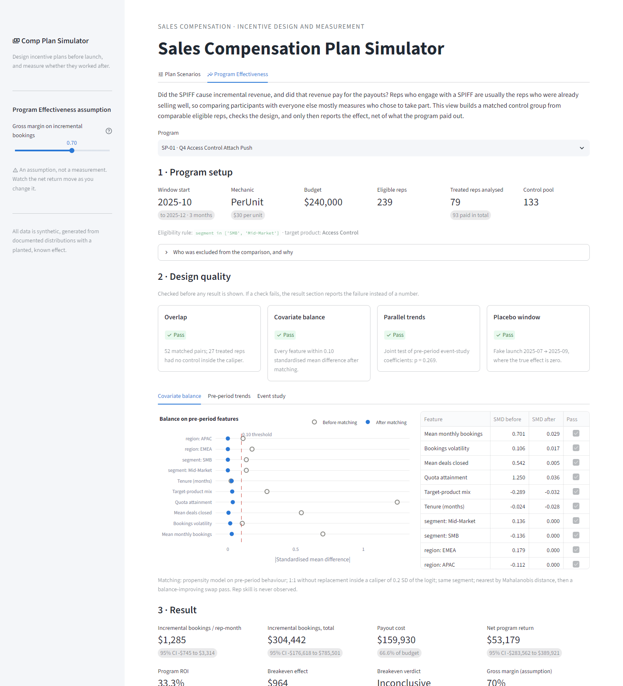
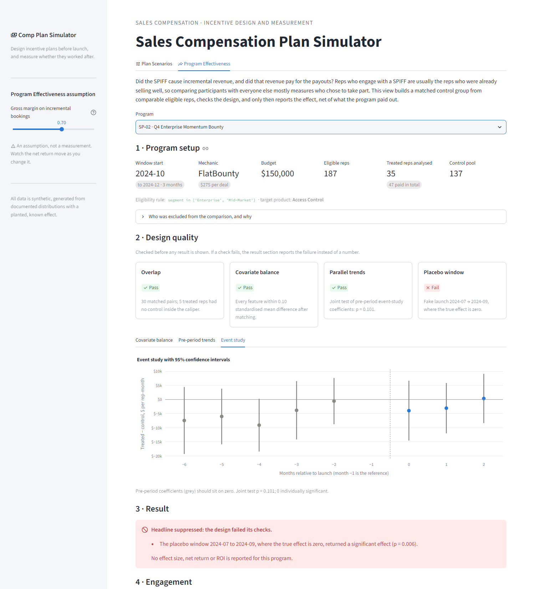
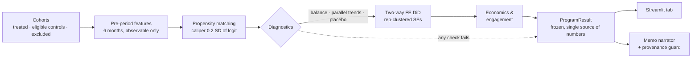
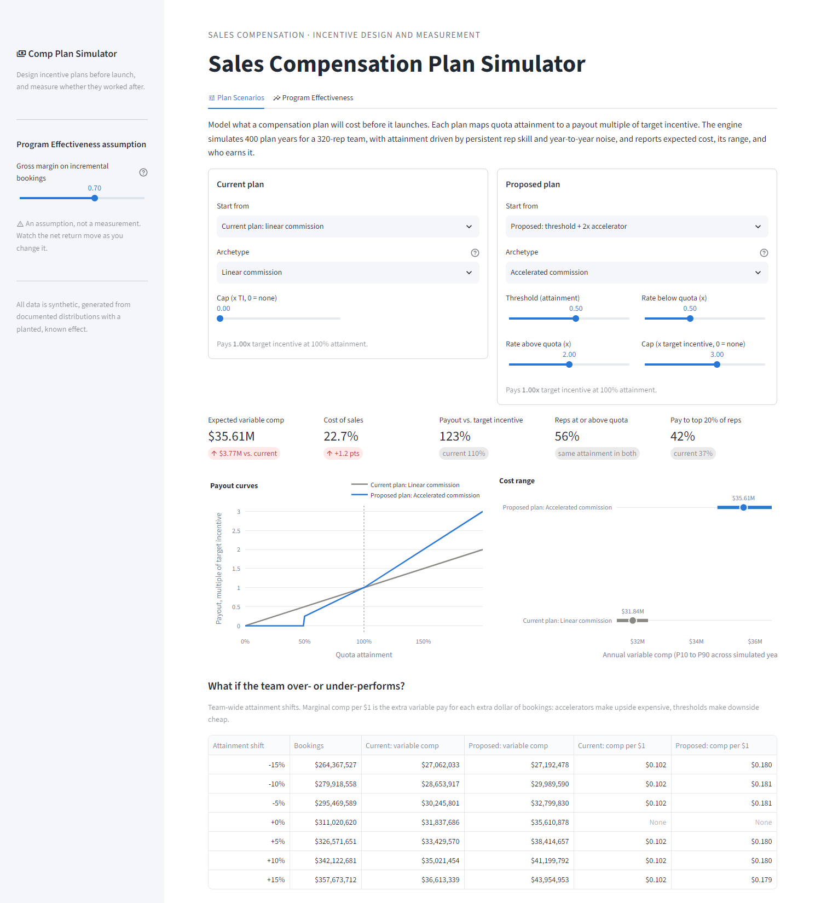

# Sales Compensation Plan Simulator

Two questions a commercial operations team gets asked about incentive plans, one before launch and one after:

| | Question | Module |
|---|---|---|
| **Before** | If we change the plan, what will it cost? | **Plan Scenarios** (`comp_sim/`): Monte Carlo cost model for commission and bonus plan archetypes |
| **After** | Did the SPIFF we ran actually cause anything, and did it pay for itself? | **Program Effectiveness** (`spiff_effectiveness/`): propensity-matched difference-in-differences, validated against a planted effect |



> **All data is synthetic.** The rep panel is generated by a seeded script with a **known, planted treatment effect**: an 8% lift on target-product bookings for participating reps, 30% of which is cannibalised from other products. Because the true answer is known, the estimator can be checked against it. That check is the point of the project.

---

## Program Effectiveness

### The problem

After a SPIFF closes, the usual readout compares reps who earned the SPIFF with reps who didn't. That comparison is wrong. Reps who engage with a SPIFF are the reps who were already selling well, so the gap mostly measures **who chose to take part**. A before-and-after comparison of participants is also wrong, because quarter-end seasonality and the overall growth trend move every rep at once.

On the default data, the naive participant-vs-non-participant gap is **$20,334 per rep-month**. The matched difference-in-differences estimate of the program's effect on total bookings is **$1,285** (95% CI −$745 to $3,314).

### Answer the hard questions first

- **The data is synthetic.** This demonstrates a measurement design, not a finding about a real sales force.
- **Matching only corrects for what is observed.** Propensity matching uses pre-period behaviour: bookings, volatility, deals, attainment, product mix, tenure, segment and region. Unobserved drivers of participation, such as rep motivation and territory quality, remain a threat. The generator includes one (rep skill, never shown to the estimator) and the design recovers the effect anyway. That is evidence, not proof, for real data.
- **Parallel trends is an assumption.** It can be supported by evidence (the event study and the placebo window) and never proven. On some seeds the momentum-selected program (SP-02) passes both checks even though its participants were chosen on recent growth. The diagnostics have limited power, and the README says so rather than hiding it.
- **Gross margin is an input, not a measurement.** Net return and ROI move with it. The sidebar control exists so a reviewer can watch that happen.
- **Spillover is not modelled.** If a SPIFF changes team behaviour broadly, control reps are contaminated and the effect is understated.
- **Total-bookings effects are hard to detect.** The planted lift is 8% on one product line, which is about 1.6% of a rep's total bookings, inside normal month-to-month noise. In validation, the target-product effect is detected 95% of the time and the total-bookings effect 18% of the time. A wide interval is the correct answer in that situation.

### Validation against the planted effect

`python -m spiff_effectiveness.validate --runs 100` regenerates the panel under 100 seeds, runs the unmodified pipeline on each, and compares the estimate with the answer it was never shown. Results are in [`docs/validation.json`](docs/validation.json).

| Acceptance criterion | Required | Result (of 100) |
|---|---|---|
| **Recovery**: 95% CI contains the planted target-product effect | ≥ 90 | **100** |
| Recovery: 95% CI contains the planted total-bookings effect | ≥ 90 | **97** |
| **Null**: with the planted effect set to 0, total-bookings estimate non-significant | ≥ 90 | **100** |
| **Placebo**: fake pre-period window returns a non-significant effect | ≥ 95 | **98** |
| **Balance**: every feature's SMD below 0.10 after matching | default seed | **100** |

| Mean across 100 runs | Planted truth | Estimate |
|---|---|---|
| Target-product effect, $ per treated rep-month | $1,487 | $1,482 |
| Total-bookings effect, $ per treated rep-month | $1,041 | $1,159 |
| Naive participant-vs-non-participant gap | n/a | $12,173 |

The other acceptance criteria are unit tests: selection correction, determinism (byte-identical `ProgramResult` for the same seed), unbalanced panels, the insufficient-overlap path, and the provenance guard. All run in CI ([`.github/workflows/ci.yml`](.github/workflows/ci.yml)).

### Three programs, three outcomes

The program registry is built so each program exercises a different path through the pipeline:

| Program | How participants were selected | What the module reports |
|---|---|---|
| **SP-01** Q4 Access Control Attach Push | Rep skill and prior-year attainment | **Result.** Target-product lift $1,466 per rep-month (95% CI $411 to $2,520). Total-bookings effect not distinguishable from zero. Net return $53,179 (95% CI −$283,562 to $389,921). **Breakeven inconclusive.** |
| **SP-02** Q4 Enterprise Momentum Bounty | Recent momentum (growth in the months before launch) | **Headline suppressed.** The placebo window returns a significant fake effect (p = 0.006): the cohorts were already diverging. |
| **SP-03** APAC New-Hire Access Control Sprint | Tiny eligible pool | **Insufficient overlap.** Only 3 treated reps find a comparable control; the minimum is 20. |

When a diagnostic fails, the numbers are not shown with a caveat underneath. They are withheld: `ProgramResult.estimates` is `None`, so no surface can display them.



### Measurement design



1. **Cohorts** ([`cohorts.py`](spiff_effectiveness/measure/cohorts.py)). Treated means eligible with at least one payout in the window. Controls are eligible reps who were not treated. Four groups are excluded, each reported in the UI:
   - reps that fail the eligibility rule (structurally different, so never used as controls)
   - reps paid by another program during the analysis span
   - new hires still ramping
   - reps with too little pre-period history
2. **Features** ([`features.py`](spiff_effectiveness/measure/features.py)). For the 6 months before launch: mean bookings, volatility, mean deals, quota attainment, target-product mix, tenure, segment and region. Rep skill is generated but the loader never selects it.
3. **Matching** ([`matching.py`](spiff_effectiveness/measure/matching.py)).
   - A logistic propensity model predicts participation.
   - Each treated rep is matched 1:1 without replacement, inside a caliper of 0.2 SD of the logit.
   - Matches must share a segment; the nearest candidate by Mahalanobis distance wins.
   - A swap pass then improves balance.
   - The UI shows standardised mean differences before and after matching.
4. **Parallel trends** ([`diagnostics.py`](spiff_effectiveness/measure/diagnostics.py)). An event study with period-relative dummies, plus a joint Wald test that all pre-period coefficients are zero.
5. **Estimate** ([`did.py`](spiff_effectiveness/measure/did.py)). `y_it = α_i + γ_t + β·(Treated_i × Post_t) + ε_it`, with standard errors clustered by rep. It runs on total bookings and on target-product bookings. The cannibalisation rate is `1 − β_total / β_target`, with a delta-method CI from the joint cluster covariance.
6. **Falsification.** The whole pipeline (features, matching, DiD) is re-run on a placebo window placed at the end of the pre-period, where the true effect is zero.

### Choices that differ from the textbook version, and why

These came out of validating against the planted effect. Each one was a measured problem, not a preference.

| Choice | Why |
|---|---|
| Within the propensity caliper: exact segment, Mahalanobis distance, then a balance swap pass | With about 60–70 matched pairs, chance alone moves each feature's SMD by roughly ±0.17. Pure nearest-neighbour on the propensity score almost never keeps all 12 features under 0.10. The caliper is unchanged, and the textbook rule is still available (`match_method="pscore"`). |
| Joint test of pre-period coefficients | Testing five coefficients one at a time would reject a valid design about 23% of the time at α = 0.05. Individual coefficients and CIs are still plotted. |
| New hires in their ramp period are excluded | Validation showed the total-bookings estimate running about 50% high. The cause was ramp-up growth among recent hires, which matching on tenure alone did not neutralise. Excluding reps hired within 6 months of the pre-period removed the bias (from +$417 ± $142 to +$105 ± $94 across seeds). Many comp teams already exclude ramping reps from incentive evaluation. |
| SP-01 selects on **prior fiscal-year** attainment | When selection used the same six months as the placebo window, the placebo fired in about 13% of valid runs. Reps who joined because of a strong recent stretch carried it into the placebo window. Selecting on prior-year attainment is also a common real design ("last year's top performers"). |
| Default seed chosen by a declared rule | The default is the first seed where all three programs take their designed path and SP-01's errors against truth fall in the middle 50% of their 100-run distribution. That keeps the demo representative rather than lucky or unlucky. |

### Metric definitions

Every reported number is one of these, computed once in [`assemble.py`](spiff_effectiveness/report/assemble.py).

| Metric | Formula |
|---|---|
| ATT per rep-month | β from the two-way fixed effects regression, total bookings |
| Target-product ATT | Same regression, target-product bookings |
| Cannibalisation rate | 1 − total ATT ÷ target-product ATT |
| Incremental bookings | ATT × treated reps × months in window |
| Program payout cost | Sum of payouts in the window (actual spend, not budget) |
| Budget utilisation | Payout cost ÷ budget |
| Incremental gross profit | Incremental bookings × gross margin (**assumption**, default 70%) |
| Net program return | Incremental gross profit − payout cost |
| Program ROI | Net program return ÷ payout cost, always with its CI |
| Breakeven ATT | Payout cost ÷ (treated reps × months × gross margin) |
| Breakeven verdict | *cleared* if the whole ATT CI is above breakeven, *not cleared* if below, otherwise *inconclusive* |
| Participation rate | Participants ÷ eligible reps |
| Payout concentration | Share of payout earned by the top 20% of participants |
| Time to first payout | Median days from launch to a rep's first payout (payouts post monthly) |
| Naive reads (for contrast only) | Window bookings of participants − non-participants; participants' window − pre-period bookings |

Every causal figure carries its 95% confidence interval wherever it appears.

### One source of numbers

`assemble.py` produces a frozen `ProgramResult`, and every surface downstream is a renderer.

- **Streamlit tab** ([`spiff_page.py`](spiff_effectiveness/app/spiff_page.py)): formats fields of `ProgramResult` and does no arithmetic. Even confidence-interval whiskers are drawn from the stored bounds.
- **Memo narrator** ([`narrate.py`](spiff_effectiveness/report/narrate.py)): receives `ProgramResult` as display strings, never raw tables, and returns a one-page post-mortem for sales leadership. The model is told to copy every number verbatim and to do no arithmetic. When a diagnostic failed, it must lead with the limitation and state no effect size.
- **Provenance guard:** pulls every numeric token from each draft and checks it against the payload. A draft with any unmatched number is rejected, logged and regenerated (up to 3 attempts), then replaced with a template memo built from the same payload. Every draft is logged, accepted or not, in [`provenance_guard_log.jsonl`](spiff_effectiveness/report/logs/provenance_guard_log.jsonl).
  - During development the guard caught the model writing "95% CI" before the confidence level was part of its input. That is a number the model supplied from its own knowledge, which is exactly what the guard exists to stop. The payload now carries it.
  - The current log shows every production draft passing on the first attempt.
  - A unit test injects a fabricated figure into a mocked response and asserts it is rejected.

Sample memos: [SP-01](docs/sample_memos/SP-01.md) (result), [SP-02](docs/sample_memos/SP-02.md) (suppressed), [SP-03](docs/sample_memos/SP-03.md) (no overlap).

### What a real deployment would need to replace

- **The generator.** Point `data/loader.py` at real tables with the same four schemas: reps, monthly bookings, program registry and payouts.
- **The gross margin assumption.** Replace it with product-level margin from finance.
- **Payout timing.** Use payout dates rather than months, so time to first payout is measured in days.
- **Spillover.** Add a spillover check, such as comparing ineligible teams before and after.
- **Contamination rules.** Validate the rules against the real program calendar.
- **Pre-registration.** Agree the evaluation window, the outcome and the breakeven effect before launch.

---

## Plan Scenarios



Compare a current and a proposed plan across 400 simulated plan years for a 320-rep team. Attainment combines persistent rep skill with year-to-year noise, so about 56% of reps reach quota.

- **Archetypes:**
  - linear commission
  - accelerated commission (threshold, decelerator, accelerator, cap)
  - tiered commission
  - capped target bonus with a kicker
- **Outputs:**
  - expected variable comp and its P10–P90 range
  - cost of sales
  - payout vs. target incentive
  - share of pay going to the top 20% of reps
  - payout curves
  - payout distribution by segment
  - a sensitivity table showing the **marginal comp cost of each extra dollar of bookings** under team-wide over- and under-performance (accelerators make upside expensive; thresholds make downside cheap)

## Run it

```bash
python -m venv .venv
source .venv/bin/activate              # Windows: .venv\Scripts\activate
pip install -r requirements.txt
streamlit run app.py                   # generates the synthetic panel on first run
```

Optional:
- `export ANTHROPIC_API_KEY=...` enables AI-drafted memo narratives. Without it the template memo is used.
- `pytest -m "not simulation"` runs the fast tests (about 15s).
- `pytest` also runs the three 100-run simulation tests (about 4 minutes).
- `python -m spiff_effectiveness.generate.programs` regenerates the Parquet panel.
- `python -m spiff_effectiveness.validate` rewrites `docs/validation.json`.

## Layout

```
app.py                        Streamlit app: Plan Scenarios and Program Effectiveness tabs
comp_sim/                     forward-looking plan cost model
  config.py  plans.py  engine.py  app/scenario_page.py
spiff_effectiveness/
  config.py                   planted truth (generator only) and measurement settings
  generate/panel.py           reps, counterfactual bookings: skill, trend, seasonality, drift, churn
  generate/programs.py        program registry, selection, payouts, planted effect and cannibalisation
  data/loader.py              DuckDB views over Parquet; never selects latent skill or truth
  measure/                    cohorts, features, matching, diagnostics, did, economics, engagement
  report/assemble.py          ProgramResult, the single source of numbers
  report/narrate.py           memo narrator and provenance guard
  validate.py                 100-seed validation against the planted effect
  app/spiff_page.py           Program Effectiveness tab
  tests/                      PRD acceptance criteria
docs/                         DATA.md, validation.json, sample memos, screenshots
```

Data generation is documented in [docs/DATA.md](docs/DATA.md).
